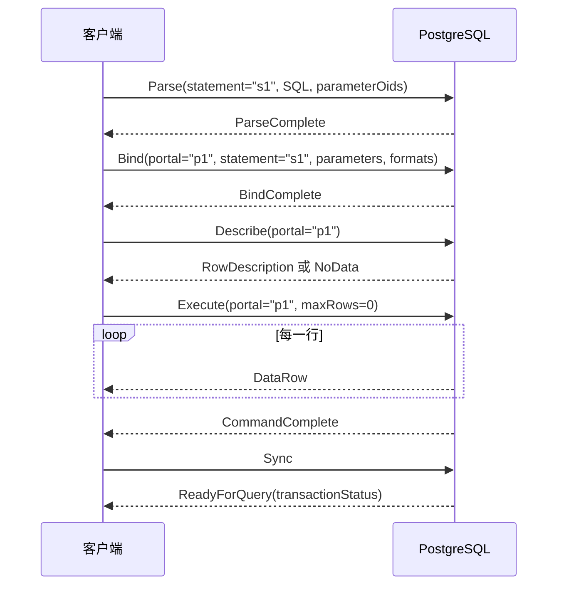
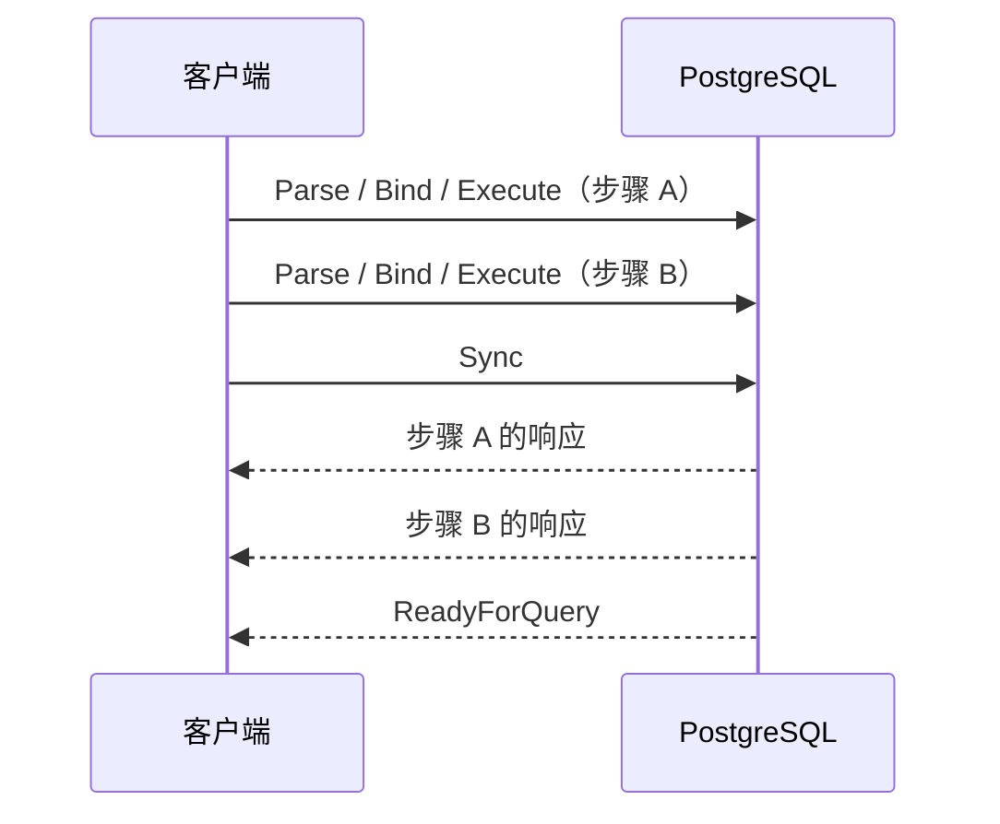
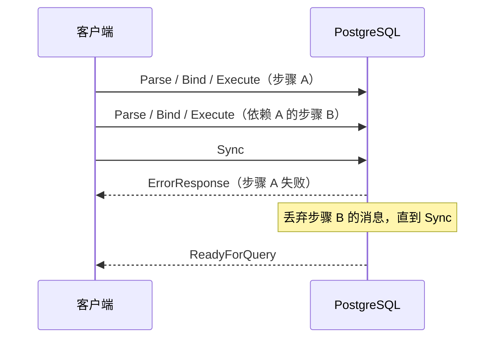
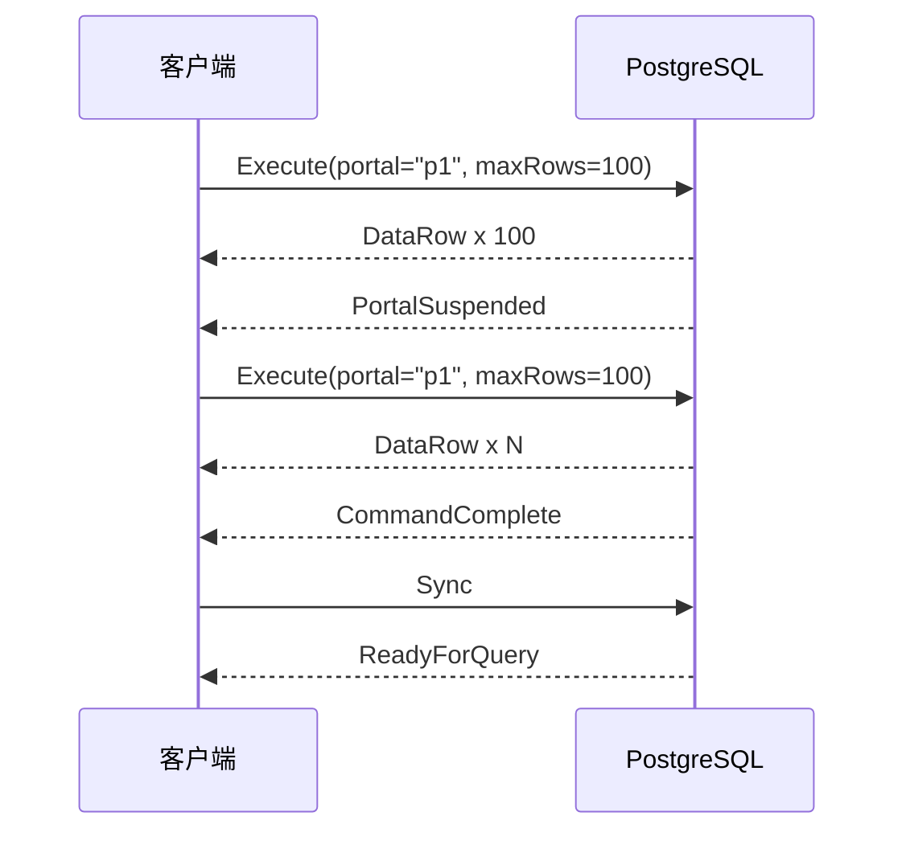
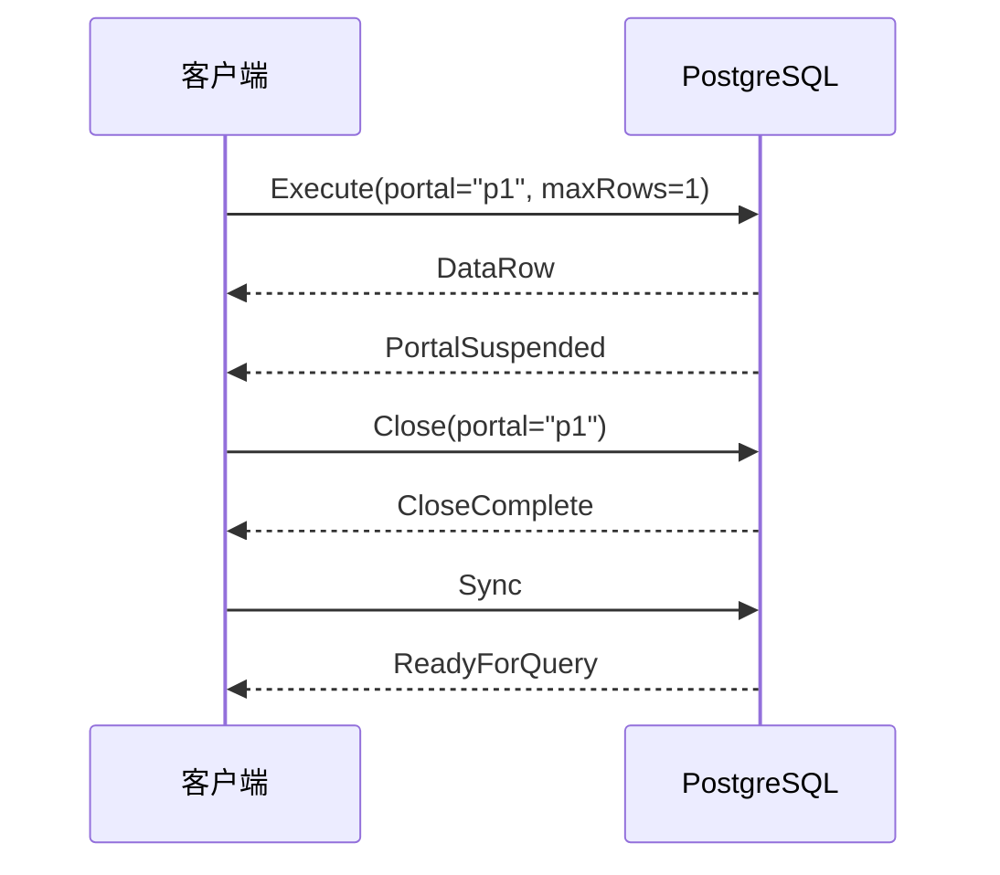
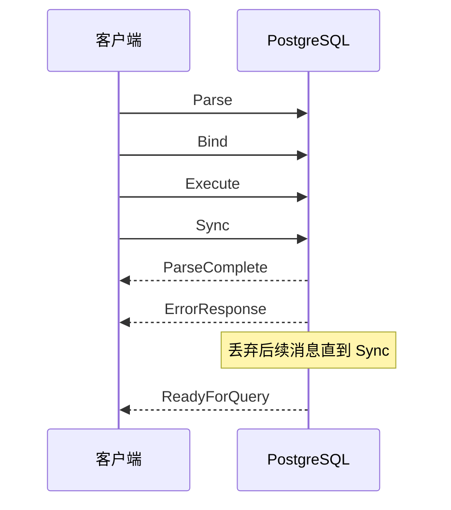

# PostgreSQL 扩展查询协议

扩展查询协议（Extended Query
Protocol）把一次查询拆分为多个前端消息，使客户端能够安全地传递参数、复用预备语句、选择文本或二进制格式，并通过 Portal
分批读取结果。

核心消息序列通常是：

```text
Parse -> Bind -> Describe（可选）-> Execute -> Sync
```

## 核心对象

- **Prepared Statement**：`Parse` 创建的已解析语句。它保存 SQL 和参数类型，但查询计划通常到 `Bind` 时才生成。
- **Portal**：`Bind` 创建的执行上下文，包含具体参数和结果格式。`Execute` 操作的是 Portal，而不是 Prepared Statement。
- **名称与作用域**：Prepared Statement 和 Portal 使用各自独立的名称空间，且只属于当前连接，不能跨连接复用。
- **匿名对象**：名称为空字符串 `""`，仍然是实际存在的对象。Statement 与 Portal 的销毁条件不同，见下文生命周期说明。

## 完整流程



客户端可以把 `Parse`、`Bind`、`Describe`、`Execute` 和 `Sync`
连续写入网络，而不必等待每一步响应。服务端仍按顺序处理并返回消息，这能减少网络往返。

## 各阶段语义

### Parse

`Parse` 包含 Prepared Statement 名称、单条 SQL 和可选的参数类型 OID。一个 `Parse` 中不能包含多条 SQL。

参数类型可以：

- 显式指定 OID。
- 使用 `0` 表示未指定。
- 少于 SQL 中的参数数量，让服务端推断剩余类型。

成功响应为 `ParseComplete`，失败响应为 `ErrorResponse`。

### Bind

`Bind` 把参数绑定到 Prepared Statement，并创建 Portal。消息同时指定：

- 每个参数采用文本还是二进制格式。
- 参数原始字节，`-1` 长度表示 SQL `NULL`。
- 查询结果采用文本还是二进制格式。

查询规划通常发生在这个阶段。成功响应为 `BindComplete`。

同一个 Prepared Statement 可以通过多次 `Bind` 创建多个 Portal，分别保存参数、结果格式和执行进度。 `Bind` 不会执行源
SQL；即使源 SQL 是 `BEGIN` 或 `COMMIT`，也必须等到对应 Portal 的 `Execute` 才会执行事务控制命令。

### Describe

`Describe` 是可选步骤，可以描述两种对象：

- 描述 Prepared Statement：先返回 `ParameterDescription`，再返回 `RowDescription` 或 `NoData`。
- 描述 Portal：返回 `RowDescription` 或 `NoData`。

若客户端已经知道结果列布局，可以省略 `Describe`。注意 `Execute` 本身不会返回 `RowDescription`。

### Execute

`Execute` 执行指定 Portal。`maxRows` 的含义：

- `0`：执行到完成，返回全部结果。
- 大于 `0`：最多返回指定行数。

一次 Execute 阶段由以下消息之一结束：

- `CommandComplete`：命令执行完成。
- `PortalSuspended`：已达到 `maxRows`，Portal 尚未执行完。
- `EmptyQueryResponse`：Portal 来自空查询。
- `ErrorResponse`：执行失败。

`CommandComplete` 表示执行完成，不等于 Portal 被关闭，也不等于事务结束。继续读取应以 `PortalSuspended`
为依据；不要把再次 `Execute` 当作从头重新执行 SQL。需要重跑时，应重新 `Bind` 创建 Portal，命名 Portal
使用同名重建前须先关闭。

### Close

`Close` 通过目标类型和名称指定要关闭的对象：

```text
Close(type='S', name="s1")  -> CloseComplete  // 关闭 Prepared Statement
Close(type='P', name="p1")  -> CloseComplete  // 关闭 Portal
Close(type='P', name="")    -> CloseComplete  // 关闭匿名 Portal
```

匿名 Prepared Statement 也可以用 `Close(type='S', name="")` 显式关闭。 关闭 Prepared Statement 不会关闭已经从它创建的
Portal；关闭 Portal 也不会关闭其来源 Prepared Statement。 关闭后的名称可以重新使用。

### Sync

`Sync` 建立扩展查询协议的同步点。服务端处理到它后返回 `ReadyForQuery`，其中包含当前事务状态：空闲、事务中或失败事务中。

若当前不在显式事务中，`Sync` 会结束隐式事务：前面的操作成功则提交，失败则回滚。它不会提交由 `BEGIN` 打开的显式事务。

## Prepared Statement 与 Portal 的生命周期

### Parse 创建的 Prepared Statement

| 对象           | 存续与替换规则                                                             |
| -------------- | -------------------------------------------------------------------------- |
| 命名 Statement | 成功创建后跨事务保留，直到显式关闭或会话结束；不能用同名 `Parse` 直接覆盖  |
| 匿名 Statement | 下一次针对空名称的 `Parse` 会替换它；简单查询协议的 `Query` 消息也会销毁它 |

`COMMIT`、`ROLLBACK` 或结束隐式事务的 `Sync` 不会仅因事务结束而销毁 Prepared Statement。 因此可以在一次 `Parse`
后跨多个事务重复 `Bind`，但 Prepared Statement 不是查询结果缓存。

```text
Parse(statement="s1", sql="SELECT 1")  -> ParseComplete
Parse(statement="s2", sql="SELECT 2")  -> ParseComplete  // s1 与 s2 共存
Close(type='S', name="s1")             -> CloseComplete
Parse(statement="s1", sql="SELECT 3")  -> ParseComplete  // 同名重定义前先关闭
```

如果省略这里的 `Close`，第二次创建 `s1` 会返回 `ErrorResponse`，而不是替换旧对象。

### Bind 创建的 Portal

| 对象        | 存续与替换规则                                                                      |
| ----------- | ----------------------------------------------------------------------------------- |
| 命名 Portal | 保留到显式关闭或所属事务结束；同名 `Bind` 前必须先关闭旧 Portal                     |
| 匿名 Portal | 同样受事务边界限制；下一次针对空名称的 `Bind` 会替换它，简单 `Query` 消息也会销毁它 |

这里讨论的是协议 `Bind` 创建的普通 Portal，不包括 SQL `DECLARE ... WITH HOLD` 游标。 Portal 即使尚未执行、已经返回
`CommandComplete` 或正处于 `PortalSuspended`，也受上述销毁条件约束。

多个命名 Statement 和 Portal 可以共存，客户端可以交替 `Execute` 不同 Portal，服务端仍按消息顺序执行。 SQL
的业务分组、Statement 名称和 Portal 名称不会形成独立事务；生命周期取决于当前连接实际的事务边界。

### 事务边界如何影响 Portal

- **没有显式 `BEGIN`**：`Parse`、`Bind` 等消息可能已经启动隐式事务。`Sync` 结束该事务时，会销毁其中所有普通
  Portal，包括已经 `Bind` 但从未 `Execute` 的 Portal。
- **已执行 `BEGIN`**：`Sync` 不结束显式事务，正常情况下 Portal 可以跨多个 `Sync` 继续读取。必须真正执行 `BEGIN`，仅仅
  `Parse` 或 `Bind` 它不够。
- **执行 `COMMIT` 或 `ROLLBACK`**：事务在该命令执行时结束，不必等下一个 `Sync`，相关 Portal 随即失效。
  事务错误也可能提前使 Portal 失效，错误恢复见下文。
- **隐式事务中途执行 `BEGIN`**：进入显式事务块，不会创建独立的嵌套事务，也不会把已有 Portal 隔离在事务之外；
  后续提交或回滚同样影响这些 Portal。

假设命名 Statement `s_begin`、`s_commit` 和 `s_users` 已分别解析为 `BEGIN`、`COMMIT` 和用户查询， 以下流程可以跨 `Sync`
分批读取：

```text
Bind(portal="p_begin", statement="s_begin")
Execute(portal="p_begin", maxRows=0)       -> CommandComplete("BEGIN")
Bind(portal="p_users", statement="s_users")
Execute(portal="p_users", maxRows=10)      -> DataRow ... / PortalSuspended
Sync                                     -> ReadyForQuery(T)
Execute(portal="p_users", maxRows=10)      // 继续读取，不是从头执行
Bind(portal="p_commit", statement="s_commit")
Execute(portal="p_commit", maxRows=0)      -> CommandComplete("COMMIT")
                                         // 事务结束，p_users 等普通 Portal 被销毁
Sync                                     -> ReadyForQuery(I)
```

上例假设查询有足够的行返回 `PortalSuspended`。`T` 表示仍处于显式事务中，`I` 表示当前不在事务中。

反之，先批量 `Bind` 再在执行 `BEGIN` 前发送 `Sync`，会使后续执行失败：

```text
Bind(portal="p_begin", statement="s_begin")
Bind(portal="p_users", statement="s_users")
Execute(portal="p_users", maxRows=10)
Sync                                     -> ReadyForQuery(I)，两个 Portal 均被销毁
Execute(portal="p_begin", maxRows=0)       -> ErrorResponse：Portal 不存在，BEGIN 未执行
Execute(portal="p_users", maxRows=10)      // 因前一步错误而被跳过
Sync                                     -> ReadyForQuery(I)，完成错误恢复
```

此时 Statement 仍可复用，但必须重新 `Bind`。重新创建的 Portal 是新的执行实例，不能恢复旧 Portal 的读取进度。
若不希望结束隐式事务，只需要读取中间响应，可发送 `Flush` 刷新服务端输出，而不是 `Sync`。

以上规则参见 PostgreSQL
官方文档的[扩展查询流程](https://www.postgresql.org/docs/current/protocol-flow.html#PROTOCOL-FLOW-EXT-QUERY)。

## 流水线

扩展查询协议支持流水线（pipelining）：客户端可以连续发送多组扩展查询消息，而不等待前一组查询完成，从而减少网络往返次数。



服务端仍按接收顺序执行并返回响应。客户端在发送后续命令前不等待响应，因此必须预先定义前序操作失败时后续操作的处理方式。

### 使用 Sync 划分依赖段

扩展查询遇到错误时，服务端发送 `ErrorResponse`，随后丢弃普通前端消息，直到收到 `Sync`。因此，把相互依赖的步骤放在同一个
`Sync` 之前，可以使前序错误自动跳过该段剩余命令：



可独立提交的流水线段应使用不同的 `Sync` 分隔。若没有显式 `BEGIN`，每个 `Sync`
通常结束一个隐式事务：该段成功时隐式提交，失败时隐式回滚。使用显式事务包裹整条流水线也能使其整体原子，但不能让其中的段独立提交。

某些不能在事务块中执行的 DDL（例如 `CREATE DATABASE`）必须是某个 `Sync` 后的第一条命令；成功后会立即提交。紧随其后的
`Sync` 仅会产生 `ReadyForQuery`。

### 判断流水线完成

流水线完成不能依赖 `CommandComplete` 的数量：错误后被跳过的命令不会产生完成消息。客户端必须记录发送的 `Sync`
数量，并读取相同数量的 `ReadyForQuery`。

## 分批读取

当 `maxRows` 大于 `0` 时，可以对同一个 Portal 重复发送 `Execute`：



`PortalSuspended` 表示还可以继续执行；只有收到 `CommandComplete` 才表示源 SQL 已执行完成。

### 只读取一行并放弃剩余结果

假设查询能够返回一万行，但客户端只想读取第一行，可以把 `Execute` 的 `maxRows` 设为 `1`。服务端返回一条 `DataRow` 和
`PortalSuspended` 后，客户端发送 `Close` 关闭 Portal，再发送 `Sync`，并持续读取到 `ReadyForQuery`：



不能在读取第一条 `DataRow` 后直接停止读取，否则连接中仍有当前命令的响应消息，连接无法安全复用。客户端必须读取到
`PortalSuspended`，并完成 `Close` 和 `Sync` 对应的响应。

这种方式可以避免将剩余行全部传输给客户端，但数据库可能仍需完成部分扫描、排序或连接操作。如果业务语义本来就是“最多一行”，应优先在
SQL 中使用 `LIMIT 1`，让优化器有机会减少数据库端的工作量。

## 错误恢复

扩展查询序列中任一消息处理失败时，服务端发送 `ErrorResponse`，随后丢弃普通前端消息，直到读取到 `Sync`：



因此客户端遇到 `ErrorResponse` 后不能立即复用连接，必须继续读取到与 `Sync` 对应的
`ReadyForQuery`。流水线发送多个同步段时，应按发送的 `Sync` 数量统计 `ReadyForQuery`，不能仅依赖 `CommandComplete`。

## 与简单查询的区别

| 能力          | 简单查询          | 扩展查询                          |
| ------------- | ----------------- | --------------------------------- |
| 前端入口      | 单个 `Query` 消息 | `Parse`、`Bind`、`Execute` 等消息 |
| 单次 SQL 数量 | 可以包含多条 SQL  | 每个 `Parse` 只能包含一条 SQL     |
| 参数          | 需要拼入 SQL 文本 | 参数与 SQL 分离传输               |
| 数据格式      | 通常为文本        | 参数和结果均可选择文本或二进制    |
| 分批读取      | 不直接支持        | 通过 Portal 和 `maxRows` 支持     |
| 预备语句复用  | 不支持            | 支持命名 Prepared Statement       |

参数化能避免把参数内容解释成 SQL 语法，但表名、列名和排序方向等标识符不能作为普通参数绑定，仍需安全地生成或引用。

## 示例

查询目标：

```sql
SELECT * FROM users WHERE id = $1
```

对应消息：

```text
Parse(statement="s1", sql="SELECT * FROM users WHERE id = $1", parameterOids=[INT4_OID])
Bind(portal="p1", statement="s1", parameters=[123], resultFormats=[text])
Describe(target=portal, name="p1")
Execute(portal="p1", maxRows=0)
Sync()
```

这与 SQL 层的 `PREPARE`、`EXECUTE`、`DEALLOCATE` 概念相近，但并不完全等价：协议对象直接属于当前会话，并由
`Parse`、`Bind` 和 `Close` 消息管理。

## 实现要点

- 使用状态机处理响应，不要假设每一步只会收到一种消息。
- 在任意阶段都准备处理 `ErrorResponse`、`NoticeResponse`、`ParameterStatus` 和通知消息。
- 复用命名 Prepared Statement 时，确保 SQL、名称和参数类型定义一致。
- 不再使用的命名 Prepared Statement 或 Portal 应发送 `Close`，并等待 `CloseComplete`。
- 如果需要在发送 `Sync` 前读取中间响应，应发送 `Flush`，要求服务端刷新输出缓冲区。
