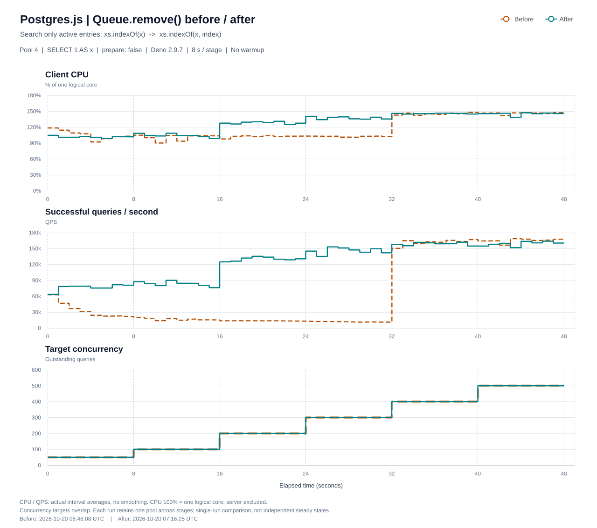

# Fix queue removal scanning already-consumed entries

## Summary

Start `Queue.remove()` searches at the queue's read index instead of the beginning of its backing array:

```diff
- const i = xs.indexOf(x)
+ const i = xs.indexOf(x, index)
```

This avoids repeatedly scanning already-consumed entries during connection-pool scheduling. It does not change the public API or the removal order of active entries.

## Problem

The queue uses an array and a read index. `shift()` advances the index and clears the consumed slot, but resets the backing array only when the queue is completely drained.

Consequently, a queue that repeatedly removes its head and appends an item can retain a growing consumed prefix even when its active length remains small:

```text
[undefined, undefined, ... a growing consumed prefix ..., connectionB, connectionC]
                                                        ^
                                                        read index
```

The pool can exercise this pattern through `busy.shift()` followed by `go()` and `move()`. `move()` first removes the connection from its previous queue before appending it to the destination queue. If the connection was already taken by `shift()`, this removal search misses.

Previously, that miss scanned the entire backing array, including its consumed prefix. When the queue does not drain, each subsequent search can become more expensive despite there being only a few active connections.

Searching from the read index bounds the search to active entries. A failed search changes from O(backing-array length) to O(active-queue length). Successful removal still uses `splice()` to preserve the contiguous active range and FIFO order.

This is a targeted search fix, not a queue redesign: it does **not** compact the backing array or eliminate redundant removal calls.

## Before / after benchmark

Only **Postgres.js** is shown below. The chart contains client-process **CPU**, successful-query **QPS**, and target **concurrency**; no other clients or resource metrics are included.



<!-- Before pasting into a GitHub PR, replace the relative image URL above with the public URL of the accompanying SVG. Local relative files are not uploaded by pasting Markdown. If the SVG is committed, use its actual repository URL. -->

### Configuration and measurement

- Client: Postgres.js 3.4.9, run under Deno 2.9.7.
- Pool: 4 connections, `prepare: false`; `max_pipeline` is not overridden (default: 100).
- Query: `select 1 as x`.
- Fixed outstanding-query targets: `50, 100, 200, 300, 400, 500`, in that order. Each completion immediately triggers replacement work; there is no target-QPS limit.
- Warmup: **0 seconds**. Each stage requests **8 seconds**, for approximately 48 seconds per run.
- Each run uses one process and one pool across all stages. Stage changes do not drain or recreate the pool.
- CPU is the client's process-wide user + system CPU time, including the load generator. **100% means one logical core**, not the whole machine; database-server CPU is excluded.
- QPS and CPU are sampled approximately once per second, with additional stage-boundary samples. The chart shows each interval's average over its actual time span, without smoothing; concurrency is a step plot of the configured stage target.
- The table uses `completedInWindow / elapsedSeconds` for each stage's QPS and interval-duration-weighted CPU averages. Final drain is excluded from these metrics.
- Both supplied runs reported zero failed or dropped queries and completed their final drain.

### Per-stage results

| Concurrency | QPS before | QPS after | QPS after / before | CPU before | CPU after |
|---:|---:|---:|---:|---:|---:|
| 50 | 33,560 | 76,502 | 2.28x | 105.63% | 101.51% |
| 100 | 16,384 | 83,290 | 5.08x | 100.44% | 104.25% |
| 200 | 13,396 | 130,097 | 9.71x | 102.31% | 128.17% |
| 300 | 11,537 | 145,745 | 12.63x | 102.37% | 137.21% |
| 400 | 161,715 | 158,736 | 0.98x | 145.02% | 145.67% |
| 500 | 164,965 | 158,978 | 0.96x | 146.24% | 145.07% |

Ratios are calculated from unrounded QPS values.

### Interpretation and limitations

- Before the change, throughput deteriorates across the early stages: at concurrency 50 alone, interval QPS falls from approximately 62,640 to 21,711. It stays low through concurrency 300, then recovers abruptly at concurrency 400.
- After the change, the early-stage collapse is no longer visible. Throughput rises from approximately 76.5k QPS at concurrency 50 to 145.7k at 300, reaching approximately 159k at 400-500.
- At concurrency 300, this run completes **12.63x** as many queries per second while client CPU rises from **102.37% to 137.21%**. Higher absolute CPU here accompanies substantially more completed work; the change is not presented as an across-the-board CPU reduction.
- The high-concurrency results are not uniformly better: QPS is **1.84% lower at 400** and **3.63% lower at 500** after the change. Repeated measurements are needed to determine whether these differences are reproducible.
- This is one before/after pair, with short stages and no warmup. The first stage includes lazy connection startup and runtime warmup. Later stages inherit state from earlier stages, so these are **not independent steady-state measurements** for each concurrency.
- Some short-term variation remains. For example, after the change, the concurrency-100 interval QPS ranges from approximately 76.0k to 89.9k. The fix removes consumed-prefix scanning; it does not promise jitter-free execution or solve backing-array growth.
- The measurements support the consumed-prefix explanation, but do not include CPU call stacks or internal queue-length traces. They do not establish an exact pipeline threshold or attribute CPU usage to individual runtime threads.

### Source runs

These are the two supplied runs from the external benchmark harness, not paths expected to exist in the Postgres.js repository:

- **Before:** `benchmark/results/2026-10-20T06-48-08-060Z/fixed-pool-4-concurrency-50-100-200-300-400-500/postgres.json`
- **After:** `benchmark/results/2026-10-20T07-16-25-245Z/fixed-pool-4-concurrency-50-100-200-300-400-500/postgres.json`

The original harness configuration can be reproduced with a reachable PostgreSQL instance and `TEST_LOGIN_DB`:

```sh
deno run -A --frozen ./benchmark/test/fixed-concurrency.bench.ts \
  --pool-size 4 \
  --concurrency=50,100,200,300,400,500 \
  --warmup 0 \
  --duration 8
```

The harness also runs other clients; this comparison extracts only the Postgres.js result. The supplied result files do not record the PostgreSQL server version, host hardware, or source revision hashes.
